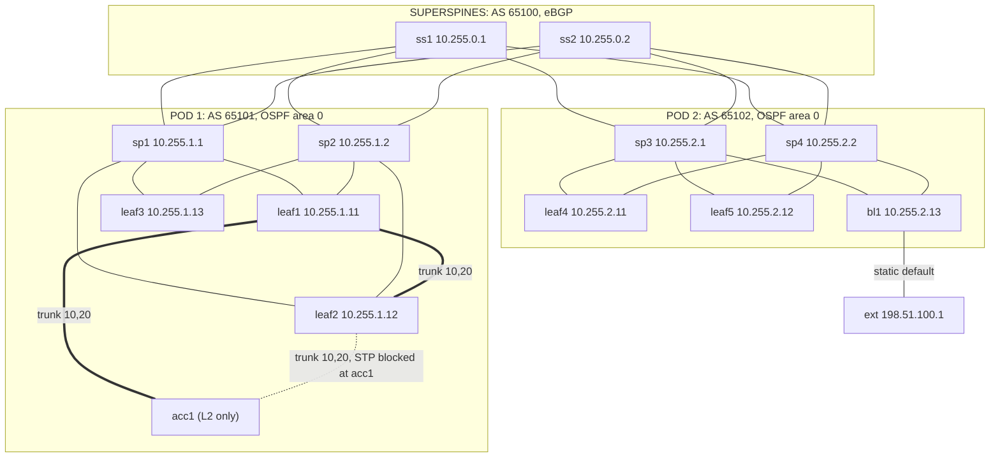

# Ethernet Switch Simulations

Simulated networks of managed Ethernet switches. Each switch is a plain `debian:trixie` container, run by [containerlab](https://containerlab.dev/) inside the `debian-13-vm` OrbStack machine. The sims generate real L2 and L3 state (MAC tables, VLANs, STP, neighbor tables, OSPF, BGP, VRRP, ECMP).

```
sims/eth-switches/
  setup.sh  # shared: debian:trixie container loader into virtual switch
  deb01.clab.yml # sim 1: 5-stage Clos, 13 L3 switches + 1 access switch, 10 hosts
  README.md
```

---

## Prerequisites

On macOS: OrbStack with `debian-13-vm` running, set up as described in the [root README](../../README.md).

On the VM, one time only. This installs Docker and containerlab:

```bash
ssh debian-13-vm@orb
curl -sL https://containerlab.dev/setup | sudo -E bash -s "all"
# log out and back in so your user picks up the docker and clab_admins groups
```

Currently tested with containerlab 0.79.0, Docker 28.5.2, and the OrbStack kernel `7.0.14-orbstack`.

## Switch Architecture

```
+------------------------------------------------------------------------------------+
|  MANAGED L3 SWITCH (debian:trixie container)                                       |
|                                                                                    |
|  +-------------+  +-------------+  +--------------------------+                    |
|  | CPU         |  | RAM         |  | sshd  (root / clab)      |                    |
|  | 2 cores     |  | 2 GB        |  | FRR   (vtysh)            |                    |
|  |             |  |             |  | lldpd (swp*)             |                    |
|  +-------------+  +-------------+  +--------------------------+                    |
|                                                                                    |
|  +------------------------------------------------------------------------------+  |
|  | FORWARDING PLANE (Linux kernel, no ASIC)                                     |  |
|  | MAC table: br0, 16,384 entries, 300 s ageing, VLAN filtering, kernel STP     |  |
|  | Routing table: static, OSPF, BGP, ECMP up to 8 paths, IPv6 max 8,192         |  |
|  | Router interfaces: SVIs (vlanN on br0), routed ports (swpN), loopback (lo)   |  |
|  +------------------------------------------------------------------------------+  |
|                                                                                    |
|  1G RJ45 (swp1-swp10)                        10G SFP+ (swp11-swp16)      MGMT      |
|  [ 1][ 2][ 3][ 4][ 5][ 6][ 7][ 8][ 9][10]   [11][12][13][14][15][16]   [eth0]      |
+------------------------------------------------------------------------------------+
```

Config (maps to topology sims):

- Container (`groups.switch` in the topology YAML):
  - `cpu: 2` and `memory: 2Gb`
  - sysctls:
    - `ip_forward` and IPv6 forwarding on
    - `rp_filter 2` (loose, so asymmetric ECMP isn't dropped)
    - `fib_multipath_hash_policy 1` (L4 ECMP hashing)
    - `arp_ignore 1` and `arp_announce 2` (needed so hosts learn the VRRP virtual MAC)
    - `ipv6.route.max_size 8192`
- Ports (`setup.sh`):
  - Total count: `16` (unwired ports are marked as `dummy` links)
  - `swp1`–`swp10`: alias `1G-RJ45`, egress `netem rate 1gbit limit 1000` (1 gbit)
  - `swp11`–`swp16`: alias `10G-SFP+`, egress `netem rate 10gbit limit 10000` (10 gbit)
  - All ports have MTU 9216 (jumbo frames)
- Bridge `br0` (`setup.sh`):
  - `vlan_filtering 1`, `stp_state 1`, `fdb_max_learned 16384`, `ageing_time 30000` (300 s), `vlan_stats_enabled 1`, MTU 9216
  - Trunk and access ports have VLAN 1 removed.
- Management:
  - `eth0` on containerlab's management network (`172.20.20.0/24`) -> VRF
  - Management routes are never redistributed into the fabric.

Port modes/types (any `swpN`):
- Access: in `br0`, untagged in one VLAN
- Trunk: in `br0`, tagged in several VLANs
- Routed: not in `br0`, with its own address (`/31` between switches)

Not modeled: a per-switch neighbor (ARP/ND) table cap. `gc_thresh1/2/3` only exist in the host's initial network namespace, so a container can't set them. Switches use the host kernel's global limits.

## Debian Container Setup on Switch Nodes

Mounted into every switch at `/lab/setup.sh` and run once at deploy through `exec`. It reads everything from the node's `env` in the topology YAML, so a new sim never needs a new script. It's safe to re-run, and its output is logged to `/var/log/switch-setup.log`.

Steps:
1. Installs packages with apt: `iproute2 ethtool lldpd tcpdump nftables procps iputils-ping kmod openssh-server frr`.
2. Management: deletes `eth0`'s default route, sets root's password to `clab`, and starts `sshd`.
3. Ports: sets the alias and egress qdisc on every `swpN`.
4. Bridge: creates `br0`, then adds `TRUNK` and `ACCESS` ports and SVI VLANs.
5. L3: adds the loopback address, routed port addresses, SVIs (`vlanN`), and VRRP macvlans (`vrrp4-N`, MAC `00:00:5e:00:01:<N>`).
6. FRR: generates `/etc/frr/frr.conf` (or copies `/lab/frr.conf` if the node mounts one), enables the daemons, and starts FRR.
7. LLDP: starts `lldpd` on `swp*`.

### Environment Setup (Per Node)

| Key | Format | Example |
|-----|--------|---------|
| `LOOPBACK` | `ip/32`, also the router ID | `10.255.1.11/32` |
| `STP_PRIORITY` | bridge priority (default 32768) | `4096` |
| `ROUTED` | `port=ip/31 ...` | `swp11=10.1.0.1/31 swp12=10.1.0.7/31` |
| `TRUNK` | `port=vlan,vlan ...` | `swp13=10,20` |
| `ACCESS` | `port=vlan ...` | `swp1=20` |
| `SVI` | `vlan=ip/prefix ...` | `10=10.1.10.2/24` |
| `VRRP` | `vlan=virtual-ip/prefix ...` | `10=10.1.10.1/24` |
| `VRRP_PRIORITY` | priority for all groups (default 100) | `200` |
| `OSPF_PORTS` | routed ports in OSPF area 0 | `swp11 swp12` |
| `OSPF_DEFAULT` | `yes` to originate a default into OSPF | `yes` |
| `OSPF_REDISTRIBUTE` | protocols into OSPF | `bgp` |
| `BGP_ASN` | local AS, enables BGP | `65101` |
| `BGP_PORTS` | routed ports to peer on | `swp15 swp16` |
| `BGP_NETWORKS` | prefixes for `network` | `0.0.0.0/0` |
| `BGP_AGGREGATES` | prefixes for `aggregate-address ... summary-only` | `10.1.0.0/16` |
| `BGP_REDISTRIBUTE` | protocols into BGP | `ospf connected` |
| `STATIC_ROUTES` | `prefix=next-hop[@distance] ...` | `0.0.0.0/0=10.1.0.4@250` |

### FRR Config for L3 Routing Setup

Every switch gets the same template. A section is written only when its environment keys are set:

- **Header:** `frr defaults datacenter`, `hostname`, and `service integrated-vtysh-config`.
- **`OSPF_PORTS`:** each port gets `ip ospf area 0`, `ip ospf network point-to-point`, and `ip ospf bfd`. `lo` and every SVI join area 0, with SVIs passive. `router ospf` gets the router ID, plus `default-information originate` and `redistribute` when set.
- **`BGP_ASN`:** `router bgp` with `no bgp ebgp-requires-policy`. Each `BGP_PORTS` port gets one neighbor, the other address of its `/31`, with `remote-as external` and `bfd`. The address family gets `maximum-paths 8`, `network`, `aggregate-address ... summary-only`, and `redistribute`.
- **`VRRP`:** on each `vlanN`, `vrrp N version 3`, `priority`, and `ip`.
- **`STATIC_ROUTES`:** `ip route <prefix> <next-hop> [distance]`.
- **Redistribution filter:** every `redistribute` goes through route-map `REDIST`. It drops routes on `eth0` and the switch's own `BGP_AGGREGATES`. Without it, the management subnet leaks into the fabric, and a spine redistributes its own aggregate's discard route into OSPF.

To hand-write one switch's config instead, bind a file to `/lab/frr.conf` on that node.

## Commands

All `containerlab` commands run on the VM, from this folder (`~/debian-os-agent/sims/eth-switches`). Replace `deb01` with the sim's name.

```bash
# 1. from macOS, repo root: push the repo to the VM
make sync

# 2. on the VM: deploy sim (2–3 minutes due to FRR installation on each switch)
ssh debian-13-vm@orb
cd ~/debian-os-agent/sims/eth-switches
containerlab deploy -t deb01.clab.yml
containerlab inspect -t deb01.clab.yml
# from any directory (if reconnecting to the VM)
containerlab inspect --name deb01
```

`-t` paths are relative to the current directory. If the file isn't found, containerlab treats the argument as a remote topology and fails with a misleading `Open /tmp/.clab/topo-*.clab.yml: permission denied`.

`make sync` uses `rsync --inplace` and skips `clab-*/`. If you sync another way, keep both. Otherwise `--delete` wipes the running lab's directory on the VM. Also, a replaced `setup.sh` no longer reaches running containers, because a single-file bind mount keeps pointing at the old file.

Getting onto a switch. Node names resolve on the VM as `clab-<sim>-<node>` (containerlab adds them to `/etc/hosts`). The password is `clab`.

```bash
# ssh from the VM
ssh root@clab-deb01-leaf1
docker exec -it clab-deb01-leaf1 bash # no password

# ssh straight from macOS, jumping through the VM
ssh -J debian-13-vm@orb root@clab-deb01-leaf1
```

Verify deployment on a switch:

```bash
vtysh # FRR CLI: show ip route, show ip ospf neighbor, show bgp summary, show vrrp
bridge vlan show; bridge fdb show br br0
ip -br addr; ip route; ip neigh
lldpcli show neighbors
cat /var/log/switch-setup.log
```

Running the harness on a switch:

```bash
# directly on the VM
cd ~/debian-os-agent && cargo build --release
scp target/release/debian-os-agent root@clab-deb01-leaf1:/usr/local/bin/harness

# from macOS
ssh -J debian-13-vm@orb root@clab-deb01-leaf1
harness
```

Updating a sim:

```bash
# after editing shared setup.sh: re-run it on a switch (works if the file was synced in place)
docker exec clab-deb01-leaf1 bash /lab/setup.sh

# after editing the sim YAML (links, env, binds): rebuild every node
containerlab deploy -t deb01.clab.yml --reconfigure

# end sim
containerlab destroy -t deb01.clab.yml --cleanup
```

## Scenarios

Not implemented yet. The planned scripts that generate L2, L3, and fault state (MAC moves and floods, VLAN changes, STP root change, storms, uplink and BGP failures, VRRP failover, default-route loss, impairment) will live in `scenarios/`. Details on running scenarios on a sim to be added. 

---

# deb01: 5-stage Clos

- 14 switches:
  - superspines: `ss1`, `ss2`
  - pod 1: `sp1`, `sp2`, `leaf1`–`leaf3`, and `acc1` (L2 only)
  - pod 2: `sp3`, `sp4`, `leaf4`, `leaf5`, and `bl1` (border leaf)
- 10 hosts: `h1`–`h10`
- `ext`: an internet stand-in holding `198.51.100.1`
- 25 containers in total, with 34 wired links and 151 dummy ports

## Topology



## Port Map

Unlisted ports are dummies.

| Switch | Ports |
|--------|-------|
| `ss1`, `ss2` | `swp11`–`swp14` routed to `sp1`–`sp4` |
| `sp1`, `sp2` | `swp11`–`swp13` routed to `leaf1`–`leaf3`, `swp15` to `ss1`, `swp16` to `ss2` |
| `sp3`, `sp4` | `swp11`–`swp13` routed to `leaf4`, `leaf5`, `bl1`, `swp15` to `ss1`, `swp16` to `ss2` |
| `leaf1` | `swp11` to `sp1`, `swp12` to `sp2`, `swp13` trunk to `acc1`, `swp14` trunk to `leaf2` |
| `leaf2` | `swp11` to `sp1`, `swp12` to `sp2`, `swp13` trunk to `acc1`, `swp14` trunk to `leaf1`, `swp1` access VLAN 20 (`h4`) |
| `leaf3` | `swp11` to `sp1`, `swp12` to `sp2`, `swp1`, `swp2` access VLAN 30 (`h5`, `h6`) |
| `leaf4` | `swp11` to `sp3`, `swp12` to `sp4`, `swp1`, `swp2` access VLAN 40 (`h7`, `h8`) |
| `leaf5` | `swp11` to `sp3`, `swp12` to `sp4`, `swp1` access VLAN 50 (`h9`), `swp2` access VLAN 51 (`h10`) |
| `bl1` | `swp11` to `sp3`, `swp12` to `sp4`, `swp1` routed to `ext` |
| `acc1` | `swp11` trunk to `leaf1`, `swp12` trunk to `leaf2`, `swp1`, `swp2` access VLAN 10 (`h1`, `h2`), `swp3` access VLAN 20 (`h3`) |

Trunks carry VLANs 10 and 20 only.

## Addressing

- **Loopbacks:** `10.255.0.x` on the superspines, `10.255.1.x` in pod 1, and `10.255.2.x` in pod 2 (values in the diagram).
- **Superspine to spine links:** `10.0.0.0/24` /31s. The superspine takes the even address.
  - ss1: sp1 `.0`, sp2 `.2`, sp3 `.4`, sp4 `.6`
  - ss2: sp1 `.8`, sp2 `.10`, sp3 `.12`, sp4 `.14`
- **Spine to leaf links:** `/31`s, with the spine taking the even address.
  - Pod 1 (`10.1.0.0/24`): sp1 to leaf1, leaf2, leaf3 is `.0`, `.2`, `.4`; sp2 to the same leaves is `.6`, `.8`, `.10`.
  - Pod 2 (`10.2.0.0/24`): sp3 to leaf4, leaf5, bl1 is `.0`, `.2`, `.4`; sp4 to the same switches is `.6`, `.8`, `.10`.
- **Border:** `bl1` `203.0.113.0/31` to `ext` `.1`.

| VLAN | Subnet | Gateway | Hosts |
|------|--------|---------|-------|
| 10 | 10.1.10.0/24 | VRRP `.1` (leaf1 `.2` master, leaf2 `.3`) | `h1` .11, `h2` .12 (on `acc1`) |
| 20 | 10.1.20.0/24 | VRRP `.1` (leaf1 `.2` master, leaf2 `.3`) | `h3` .13 (on `acc1`), `h4` .14 (on `leaf2`) |
| 30 | 10.1.30.0/24 | `leaf3` .1 | `h5` .15, `h6` .16 |
| 40 | 10.2.40.0/24 | `leaf4` .1 | `h7` .17, `h8` .18 |
| 50 | 10.2.50.0/24 | `leaf5` .1 | `h9` .19 |
| 51 | 10.2.51.0/24 | `leaf5` .1 | `h10` .20 |

## Routing

- **OSPF:** area 0 inside each pod, running on the spine-to-leaf /31s (point-to-point, with BFD) and on loopbacks. Leaf SVIs are passive.
- **eBGP:** each spine peers with both superspines, with BFD and `maximum-paths 8`.
  - Each spine advertises its pod summary (`10.1.0.0/16` or `10.2.0.0/16`, summary-only), its pod's loopbacks, and its links.
  - Each spine redistributes BGP into OSPF.
- **Default route:**
  - `bl1` has a static `0.0.0.0/0` via `ext` and originates it into pod 2's OSPF.
  - `sp3` and `sp4` advertise it to the superspines (`BGP_NETWORKS`).
  - `sp1` and `sp2` originate it into pod 1's OSPF.
  - `leaf3` has a floating static default (distance 250) via `sp1`, which is used only if the OSPF default disappears.
- **STP:** `leaf1` is root (4096), `leaf2` is backup (8192), and `acc1` uses the default. `acc1` `swp12` is blocked.
- **VRRP:** groups 10 and 20 on `leaf1` (priority 200, master) and `leaf2` (100), with preemption on.

## Deployed State Checks

| Check | Expected |
|-------|----------|
| BGP | `ss1` and `ss2`: 4 sessions Established. Each spine: 2. |
| OSPF | Each spine: 3 neighbors Full. Each leaf and `bl1`: 2. |
| BFD | Up on every routed fabric link |
| ECMP | `ss1`: 2 paths to each pod summary and to the default. `sp1`: 2 paths to pod 2 and the default, and 2 to VLANs 10 and 20 (via `leaf1` and `leaf2`). Each leaf: 2 paths to the default. |
| STP | Root `1000.*` (`leaf1`) everywhere. `acc1` `swp12` state 4 (blocking). |
| VRRP | `leaf1` Master and `leaf2` Backup for groups 10 and 20. Hosts resolve `.1` to `00:00:5e:00:01:0a` or `00:00:5e:00:01:14`. |
| Reachability | Every host and `ext` can ping every host and `198.51.100.1` (121 of 121) |
| Floating static | `leaf3`: `S 0.0.0.0/0 [250/0]` present but not selected |

```bash
x() { docker exec clab-deb01-$1 vtysh -c "$2"; }
x ss1 "show bgp ipv4 unicast summary"
x sp1 "show ip ospf neighbor"
x leaf1 "show vrrp summary"
x leaf3 "show ip route 0.0.0.0/0"
docker exec clab-deb01-acc1 bash -c 'for p in /sys/class/net/br0/brif/*; do echo ${p##*/} $(cat $p/state); done'
docker exec clab-deb01-h1 ping -c2 198.51.100.1
```